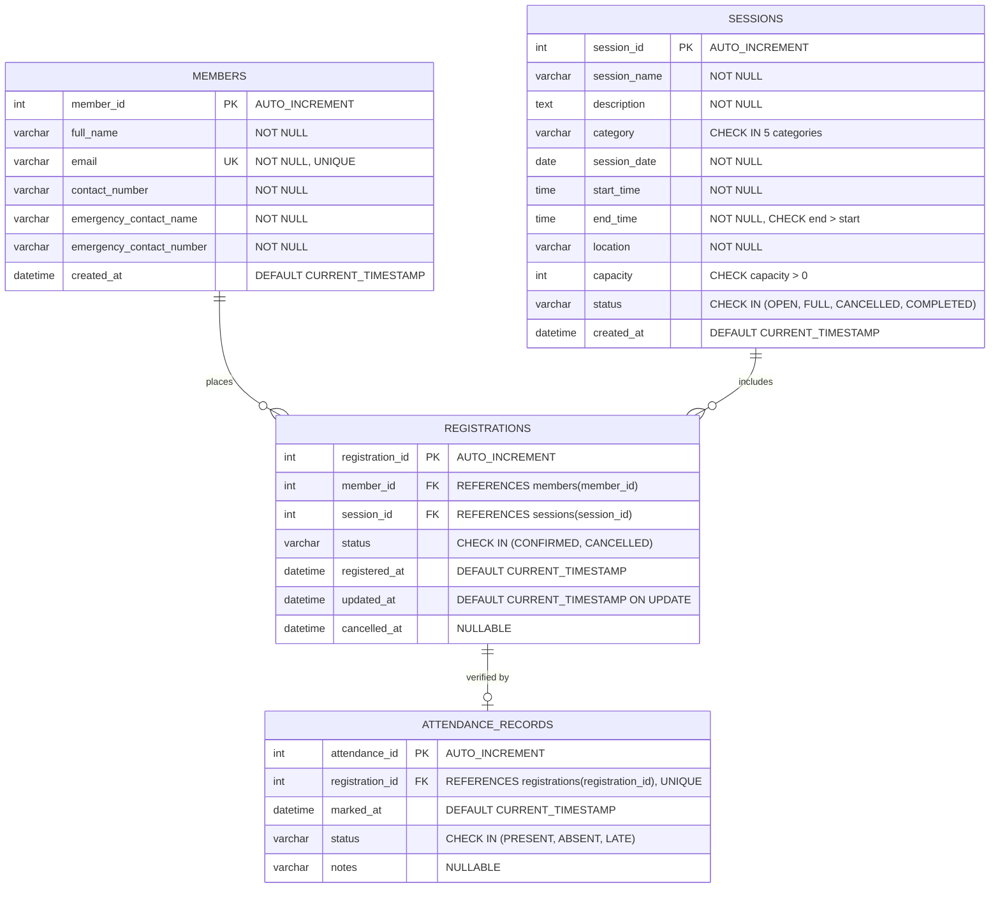

# Jogging Club Management System (JCMS) - Database Documentation

This directory contains the MySQL 8 implementation scripts and documentation for Phase 2 of the **Jogging Club Management System (JCMS)**.

---

## 1. Database Overview & Architecture

The JCMS database is designed to manage athletic club operations, including member profiles, jogging/running sessions across multiple skill levels, registration bookings, and verified physical attendance tracking.

- **Target DBMS:** MySQL Server 8.0+
- **Database Name:** `jcms_db`
- **Default Storage Engine:** `InnoDB` (ACID transactions, foreign key enforcement, row-level locking)
- **Character Set & Collation:** `utf8mb4` / `utf8mb4_unicode_ci`
- **Normalization Level:** Fully normalized to Third Normal Form (3NF)

---

## 2. Entity-Relationship Diagram (ERD)



---

## 3. Table Dictionary & Specifications

### 3.1. `members`
Stores registered jogging club members and mandatory emergency contact details.
* **`member_id`** (`INT`, PK, Auto-Increment): Unique member identifier.
* **`full_name`** (`VARCHAR(100)`, NOT NULL): Full legal name of the member.
* **`email`** (`VARCHAR(100)`, NOT NULL, UNIQUE): Unique email address used for identification.
* **`contact_number`** (`VARCHAR(20)`, NOT NULL): Primary contact telephone number.
* **`emergency_contact_name`** (`VARCHAR(100)`, NOT NULL): Full name of the emergency contact person.
* **`emergency_contact_number`** (`VARCHAR(20)`, NOT NULL): Emergency contact telephone number.
* **`created_at`** (`DATETIME`, NOT NULL): Registration creation timestamp.

### 3.2. `sessions`
Stores scheduled club running and jogging sessions.
* **`session_id`** (`INT`, PK, Auto-Increment): Unique session identifier.
* **`session_name`** (`VARCHAR(100)`, NOT NULL): Title or display name of the session.
* **`description`** (`TEXT`, NOT NULL): Comprehensive session details, route description, or gear requirements.
* **`category`** (`VARCHAR(50)`, NOT NULL): Session difficulty or purpose category. Restricted by CHECK constraint to:
  * `Beginner Jogging`
  * `Intermediate Running`
  * `Advanced Running`
  * `Family Fun Runs`
  * `Marathon Training`
* **`session_date`** (`DATE`, NOT NULL): Calendar date when the session takes place.
* **`start_time`** (`TIME`, NOT NULL): Scheduled start time.
* **`end_time`** (`TIME`, NOT NULL): Scheduled conclusion time (must be greater than `start_time`).
* **`location`** (`VARCHAR(150)`, NOT NULL): Meeting point, park, or stadium address.
* **`capacity`** (`INT`, NOT NULL): Maximum allowable participants (must be > 0).
* **`status`** (`VARCHAR(20)`, NOT NULL): Current operational status. Restricted to:
  * `OPEN`: Available for new registrations.
  * `FULL`: Active registrations have reached capacity.
  * `CANCELLED`: Session called off (e.g. adverse weather).
  * `COMPLETED`: Session has finished and attendance was taken.
* **`created_at`** (`DATETIME`, NOT NULL): Record creation timestamp.
* *Note on Normalization:* A redundant participant count is **not** stored on this table. Active participant counts are calculated dynamically when needed (`COUNT(*) WHERE status = 'CONFIRMED'`) to avoid data anomalies.

### 3.3. `registrations`
Links a member to a session booking.
* **`registration_id`** (`INT`, PK, Auto-Increment): Unique booking identifier.
* **`member_id`** (`INT`, FK, NOT NULL): References `members(member_id)`.
* **`session_id`** (`INT`, FK, NOT NULL): References `sessions(session_id)`.
* **`status`** (`VARCHAR(20)`, NOT NULL): Registration status (`CONFIRMED` or `CANCELLED`).
* **`registered_at`** (`DATETIME`, NOT NULL): Initial booking timestamp.
* **`updated_at`** (`DATETIME`, NOT NULL): Timestamp automatically updated on modification.
* **`cancelled_at`** (`DATETIME`, NULLABLE): Records when a cancellation occurred.
* *Important Constraint:* `UNIQUE KEY uq_member_session (member_id, session_id)` prevents duplicate records for the same member and session.
* *Re-registration Rule:* A cancelled registration remains in the table. Re-registering reactivates the existing row (`status = 'CONFIRMED'`, `cancelled_at = NULL`) rather than inserting a duplicate record.

### 3.4. `attendance_records`
Maintains verified physical attendance.
* **`attendance_id`** (`INT`, PK, Auto-Increment): Unique attendance check-in identifier.
* **`registration_id`** (`INT`, FK, NOT NULL, UNIQUE): References `registrations(registration_id)`.
* **`marked_at`** (`DATETIME`, NOT NULL): Timestamp when attendance was taken.
* **`status`** (`VARCHAR(20)`, NOT NULL): Attendance outcome (`PRESENT`, `ABSENT`, or `LATE`).
* **`notes`** (`VARCHAR(255)`, NULLABLE): Remarks by session coach or coordinator.
* *Separation of Concerns:* Kept strictly separate from registration history. A row is created **only** when attendance is actively marked by an organizer on the event day.

---

## 4. Key Relationships & Integrity Constraints

| Constraint Name | Type | Table | Description |
| :--- | :--- | :--- | :--- |
| `uq_member_email` | UNIQUE | `members` | Ensures no two members share the same email address. |
| `chk_member_email_format` | CHECK | `members` | Validates standard email address format pattern (`%_@__%.__%`). |
| `chk_session_category` | CHECK | `sessions` | Enforces the 5 required category names. |
| `chk_session_status` | CHECK | `sessions` | Enforces the 4 session states: `OPEN`, `FULL`, `CANCELLED`, `COMPLETED`. |
| `chk_session_time` | CHECK | `sessions` | Enforces `end_time > start_time`. |
| `uq_member_session` | UNIQUE | `registrations` | Prevents duplicate bookings for the same member and session. |
| `fk_registrations_member` | FOREIGN KEY | `registrations` | References `members(member_id)` with `ON DELETE RESTRICT ON UPDATE CASCADE`. |
| `fk_registrations_session` | FOREIGN KEY | `registrations` | References `sessions(session_id)` with `ON DELETE RESTRICT ON UPDATE CASCADE`. |
| `uq_attendance_registration`| UNIQUE | `attendance_records` | Enforces 1-to-1 relationship between a registration and its attendance mark. |
| `fk_attendance_registration` | FOREIGN KEY | `attendance_records` | References `registrations(registration_id)` with `ON DELETE RESTRICT ON UPDATE CASCADE`. |

---

## 5. SQL Script Execution Guide

The `sql/` directory contains four modular SQL scripts:

| Script | Purpose |
| :--- | :--- |
| `schema.sql` | Creates database `jcms_db`, defines all 4 tables, constraints, foreign keys, and indexes. |
| `data.sql` | Inserts realistic sample data (12 members, 10 sessions, 41 registrations, 15 attendance records). |
| `complex_queries.sql` | Demonstrates analytical queries (joins, aggregations, subqueries, dashboard metrics). |
| `transaction_demo.sql` | Demonstrates ACID transactions, row locking (`FOR UPDATE`), duplicate prevention, capacity checks, and re-registration. |

### Method 1: Using MySQL Command Line (CLI)

Open a terminal and run the scripts in order:

```bash
# 1. Execute schema creation
mysql -u root -p < sql/schema.sql

# 2. Populate sample data
mysql -u root -p < sql/data.sql

# 3. Run complex queries
mysql -u root -p < sql/complex_queries.sql

# 4. Run transaction demonstrations
mysql -u root -p < sql/transaction_demo.sql
```

### Method 2: Using MySQL Workbench (GUI)

1. Launch **MySQL Workbench** and open your local MySQL connection.
2. Select **File -> Open SQL Script...** (or press `Ctrl+Shift+O`).
3. Open `schema.sql` and click the **Execute (lightning bolt)** icon. Confirm the output panel shows table creation with green checkmarks.
4. Open `data.sql` and click **Execute**.
5. Open `complex_queries.sql` and click **Execute** to view query result grids.
6. Open `transaction_demo.sql`. You can execute the entire script or highlight individual demo blocks (`DEMO 1` through `DEMO 5`) to observe transaction commits and rollbacks.

---

## 6. Verification and Test Results

All four scripts were executed and verified against a live local **MySQL Server (v8.0.46)** on Linux:
- `schema.sql`: Executed with 0 errors. All 4 InnoDB tables, constraints, foreign keys, and indexes created.
- `data.sql`: Executed with 0 errors. Seeded 12 members, 10 sessions across all 5 categories, 41 registrations, and 15 attendance records.
- `complex_queries.sql`: All 8 analytical queries executed successfully, returning expected results.
- `transaction_demo.sql`: All 5 transaction scenarios passed successfully:
  1. Successful registration and `COMMIT`.
  2. Failed temporary registration with clean `ROLLBACK`.
  3. Capacity protection rejecting overbooking when session is full.
  4. Duplicate registration prevention via unique constraint and transactional validation.
  5. Cancellation and re-registration reactivating the existing row without duplicate generation.
